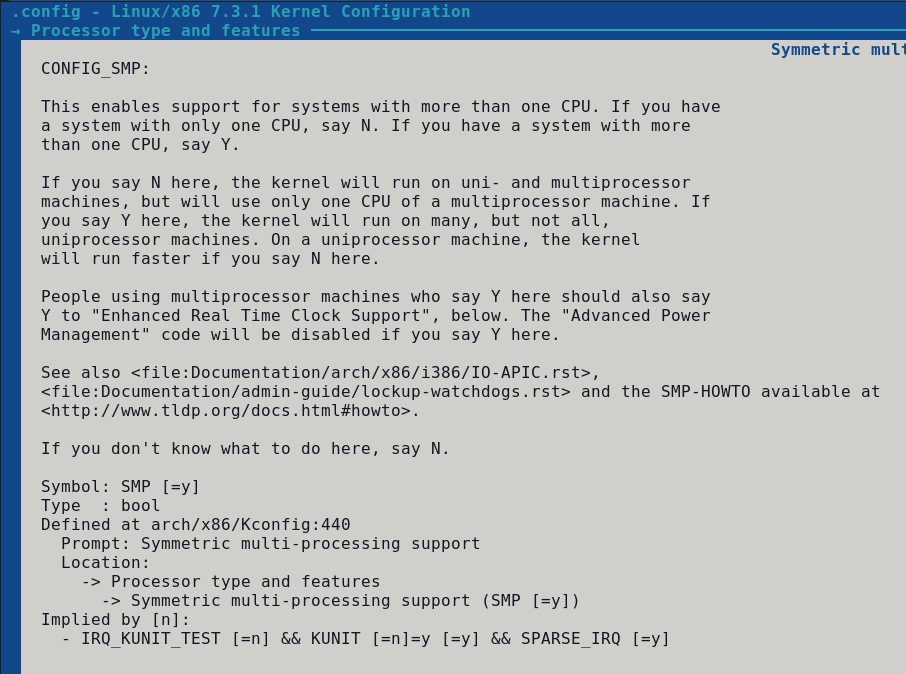
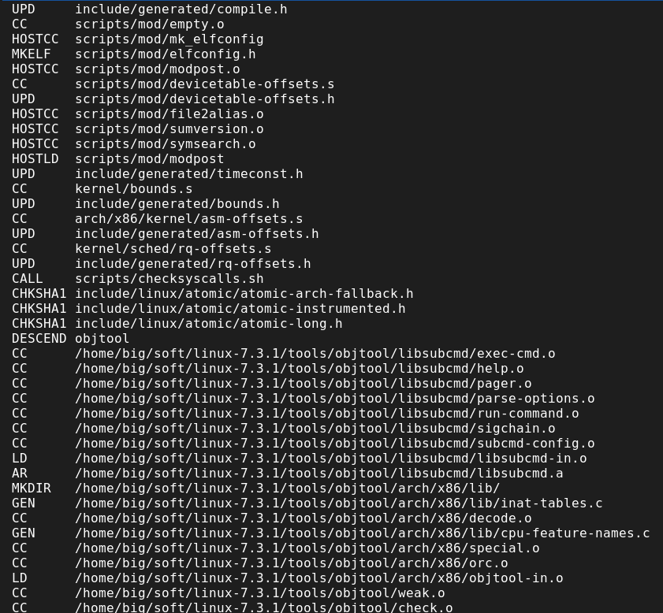

Since almost the beginning of my Linux journey and up to around the year 2005, I used a custom kernel, both on my own computer and on the servers I managed. Why did I do that and why did I stop? 


| Why?      | Why not? |
| ----------- | ----------- |
| You can optimise your kernel for the specific CPU it will be running on.     |  In the early 2000s it had a noticeable impact, not so much on today's CPUs. Plus, it only makes kernel code faster - how much time does your CPU spend on kernel code?      |
| You can make your kernel much smaller by disabling unneeded features, half of the standard size is not unusual. The kernel is always loaded into RAM, it can't be swapped out.   | When PCs typically had 4-16MB of RAM, the kernel was a sizeable portion of it. Today, wasting a few MB is not a big deal. Plus, most things like hardware drivers or filesystems are built as modules, only loaded as needed, so you have to disable whole classes of hardware to see any impact.       |
| You can add extra patches. Typically, I used to add security patches such as Openwall or grsecurity, sometimes also hardware drivers. | Many ideas from those security patches were reimplemented in the mainline Linux kernel. And I haven't seen a driver distributed as a kernel source patch for years.  |
| Disabling some kernel features reduces the attack surface and the amount of (possibly buggy) code running. | The more unneeded features you disable, the more likely you are to discover that they were, in fact, needed. You might think you don't need a certain feature, but the software you use might rely on it. You probably never explicitly used multicast or namespaces, but I bet your system uses them.   |
| You can run the newest kernel with shiny features instead of an ancient one provided by your distribution. |  Like any software, the Linux kernel has some compatibility requirements. Too new a kernel will not run or compile with an old distro. You either need to check the documentation or risk discovering it the hard way.  |
|   |  Customising and compiling a kernel takes at least half an hour of active work, plus more time (up to a few hours on a slow computer) for compilation, and you need to repeat it every time a new kernel is released. |

## Why is kernel compiling still relevant today?

The most likely reason is embedded hardware. All the arguments about CPU speed and RAM size are relevant again. On a router or a similar device that deals with the IP stack and network drivers all the time, the CPU spends most of its time running the kernel code, so any speedup of it is welcome. Plus, there's not even such a thing as a universal kernel for small ARM devices. In the PC world, the same kernel can run on a pocket-sized Intel Atom board and on a 512-core NUMA supercomputer node; even arm64 has universal packages. But low-power SoCs often require a special kernel.

Compiling kernel for embedded devices is a little bit different. You need to set up a cross-compiling environment, which used to be a pain, but became much easier with projects such as Yocto that aim to automate the build process. Still, it's a different thing, so I'll focus on compiling for a PC this time.

Another possible reason is education. You can really learn a lot about the inner workings of your system just by looking at the kernel configuration options (not even the source code). In fact, I occasionally do just the configuration step without actually compiling and using the custom kernel, which gives me 99% of the education with 1% of the problems.

Finally, you might help with debugging. Unless you're actively working on kernel development, discovering a bug that shows up in your specific setup is unlikely. But not impossible. In all my years of working with Linux, it only happened once. When it happens and you decide to contact relevant developers, they might ask you to test with different kernel versions or do some quick modifications to see how they impact your problem.

## How hard is that?

Easier than it seems. You don't need to know anything about C programming and build systems. Some knowledge about computer hardware, networking, filesystems etc. is needed if you want to customise kernel features.

### Secure Boot

One caveat is Secure Boot. Most PCs have this feature enabled, meaning they will only allow booting systems considered secure. The whole path needs to be trusted:

- UEFI, the system firmware, loads shim, the first-stage bootloader (signed by Microsoft). Shim has distribution certificates plus optionally custom ones called MOKs (Machine Owner Key).
- Shim registers a UEFI protocol called SHIM_LOCK. It's a small table of functions, stored in RAM, the main one is used to verify if a binary is trusted by Shim.
- Shim then loads Grub.
- Grub loads the kernel and uses the shim's verify function to check if it is trusted.
- The kernel loads and verifies modules.

The "proper" way to deal with it is to generate a keypair, cryptographically sign your custom kernel and modules and configure shim to trust your key. Possible, but increases the difficulty of the whole process tenfold. The easy way, especially if you're just doing a quick test, is to **disable Secure Boot**.

### Signing your kernel for Secure Boot

If you want to keep Secure Boot enabled, there are a few extra steps. Some of the steps refer to configuring and installing the kernel, described further down - come back here when you get to them. First, install the tools: `sudo apt install mokutil sbsigntool openssl` and check if Secure Boot is actually enabled with `mokutil --sb-state`.

1. Generate a keypair, a Machine Owner Key (MOK). Do it once and keep the private key somewhere safe - anyone who has it can sign code your computer will trust.

   ```bash
   openssl req -new -x509 -newkey rsa:2048 -nodes -days 3650 \
       -subj "/CN=My kernel signing key/" \
       -keyout MOK.priv -outform DER -out MOK.der
   openssl x509 -inform DER -in MOK.der -out MOK.pem
   ```

2. Enrol the key. Run `sudo mokutil --import MOK.der` and choose a one-time password. On the next reboot, shim will show a blue MokManager screen: choose "Enroll MOK", confirm and type the password. You only need to do it once, the key stays enrolled for future kernels. Afterwards, `mokutil --list-enrolled` should show your key. You cannot automate this step. This is intentional: someone needs to be present at the keyboard and physically type a password into a small tool that has no network access.

3. Take care of the modules while configuring the kernel. You don't need to sign them by hand: if the kernel is configured with `CONFIG_MODULE_SIG=y` and `CONFIG_MODULE_SIG_ALL=y` (distribution configs already have both), the build generates its own key, signs all the modules with it and embeds the public key in the kernel, which trusts it automatically. One gotcha: Debian and Ubuntu configs point to the distribution's certificates, which are not in the kernel.org sources, and the build fails. Clear these options before compiling:

   ```bash
   scripts/config --set-str SYSTEM_TRUSTED_KEYS ""
   scripts/config --set-str SYSTEM_REVOCATION_KEYS ""
   ```

4. Sign the kernel image after installing the package (replace the version with your own, `ls /boot` if unsure):

   ```bash
   sudo sbsign --key MOK.priv --cert MOK.pem \
       --output /boot/vmlinuz-6.9.0-my1.signed /boot/vmlinuz-6.9.0-my1
   sudo mv /boot/vmlinuz-6.9.0-my1.signed /boot/vmlinuz-6.9.0-my1
   sudo sbverify --cert MOK.pem /boot/vmlinuz-6.9.0-my1
   ```

   If the last command says "Signature verification OK", you're ready to reboot. Note that reinstalling the package overwrites the signed image, so you need to repeat this step every time.


## Getting the kernel source

There are several ways to get the source code. Your distribution might provide the package, but if you're going through the trouble of compiling the kernel, you probably want to get the newest one. You can download a tar.xz package from [kernel.org](https://kernel.org) and unpack it with `tar -xvJf`. If you only need one version, either to run on your embedded board or just to have a look at configuration options, that's the way to go.

However, if you're debugging a problem, developers will likely ask you to try several versions. Or to apply a patch and then revert it. The Linux kernel is stored in git (in fact, git was written for this purpose) and you can clone it just like any other repo: `git clone https://git.kernel.org/pub/scm/linux/kernel/git/stable/linux.git`. But you probably don't need the full history since the invention of git. To limit the download for example to the last 6 months, use:

```bash
git clone --no-checkout --depth 1 -b master https://git.kernel.org/pub/scm/linux/kernel/git/stable/linux.git
cd linux
git fetch --shallow-since='6 months' origin
git checkout --force --detach origin/master
```

This will first do a shallow clone (latest version only), then add 6 months' worth of latest changes and finally check out the latest version. If later you want to switch to a specific version, do `git checkout --force --detach v6.9-rc3` (careful, it will overwrite your local changes) - use `git tag` to see a list of available versions.

Shallow clones are not recommended for long-term work. If you try to add more versions, you'll probably see an error that something can't be unshallowed. Even commands like `git log` or `git blame` might fail or give strange results. If you're not a kernel developer and it's just a one-off task, it's probably OK and you just saved gigabytes of download. And if you are a kernel developer, you know it already.

Whether you choose a tar.xz file or a git clone, download it to your home directory, or any other place writable by your standard account. If you're as old as me, you might remember that Linux distros placed kernel sources in /usr/src/linux, but it's no longer recommended and hasn't been for years. The reason is you shouldn't use a root account for the compilation.

## Installing the tools

First approximation: you only need GNU make and the C compiler. But if you look at it more closely:

- I prefer to use Debian or Ubuntu, meaning I'm going to build a deb package, which requires at least dpkg-dev and realistically a few more tools. (Sidenote: if you're reading another guide and it mentions the **kernel-package** or **make-kpkg** command, be warned that it's a bit outdated. It might still be useful though, just skip that part and read below about the current way of building packages.)
- You might need to get the code from git or install a patch.
- Very likely you'll need compression libraries.
- If you want to configure the kernel with `make menuconfig` (my preferred way), you need header files for the ncurses library.
- Depending on the exact configuration, some more tools or libraries might be needed.

A good starting point for Debian or Ubuntu is: `sudo apt install build-essential debhelper dkms libncurses-dev git fakeroot libssl-dev libelf-dev pahole bison flex liblzma-dev libbz2-dev`

Package build-essential depends on make, C and C++ compilers and some essential header files; debhelper will fetch dpkg development tools; fakeroot is also needed for building a deb package; git is obvious; libncurses-dev is needed for *make menuconfig*; the rest of the tools and headers might not be needed if some kernel features are not enabled, but honestly it's just easier to install a bit too much. It might look like the list is missing many packages, but it will actually pull a lot of dependencies. You might still be missing something required for a specific kernel feature, but it should be easy to find.

Note that I didn't include any Rust tools here. Moving to Rust is a slow process. For a long time it was experimental. It's now considered a standard part of the kernel, but few things require the Rust compiler. If you do need it, kernel docs suggest to install these: `sudo apt install rustc rust-src bindgen rustfmt rust-clippy`.

## Patching the kernel source

If you downloaded a .tar.xz file, there's no need to redownload the whole package when a new kernel is released. You can get a much smaller patch file. Sometimes you might also need a patch for some extra functionality or driver. Or a kernel developer might prepare a patch for you to try.

Regardless of why you need it, the procedure is similar. Copy the file to your kernel source directory and type: `patch -p1 < name-of-patch-file`.

The parameter means: remove the first directory from the file path. The convention is to prepare the patches in such a way that the first directory is 'linux' or 'linux-5.9.3' or something like that - meaning it's one level above the kernel sources dir, which might be named differently on your computer than on the developer's system. If in doubt, you can try `patch --dry-run -p1 < name-of-patch-file`, if you see errors, adjust the number.

## Configuring the kernel

Here's where the paths diverge. Go to your kernel source directory and:

- First, edit/create the file *localversion*, add something like '-my1', this string will be appended to the kernel version. Not required, but makes it easy to differentiate between the kernels, especially if you recompile the same version with a different config. Plus, if you're compiling the same kernel version as you're currently running, you want your custom kernel to have a different version string so you don't replace the running kernel by mistake (note, some people would test a kernel in a VM, I'm assuming you're running it directly on your main machine because YOLO).
- If you want to use your current running kernel as a starting point, do `cp /boot/config-$(uname -r) .config`, if you want to use the defaults from kernel.org as a starting point, skip this step. Note that if your new kernel is close to the kernel you're already using, it's more likely to work properly.
- If you copied the running kernel config but are now compiling a different (newer) version, you can now run `make oldconfig`, this will ask you how to configure new features but skip all those already present in the config file - which usually means just a few questions.
- Another possible option is `make localmodconfig`. It will only enable the modules that are currently loaded, greatly decreasing the kernel package size and the build time. But it will also mean you might be missing a driver for a device you sometimes connect, just not at the point when you ran this command; or a network feature that wasn't used since the last reboot but will be needed tomorrow. Dangerous if you really want to use this kernel, probably OK for a quick test.
- Finally, if you want to see all configuration options - either because you want to properly customise your kernel, or you just want to have a look - run `make menuconfig` for the ncurses (text-mode GUI) interface. There are other interfaces (xconfig for Qt, gconfig for GTK or config for the simple text-mode questions) but I find this one the most comfortable.

Note that in every configuration interface you will have the possibility to read help. It provides useful information, which often ends with "If unsure, say Y". You should be careful with the recommendations, especially if they recommend saying N, as they are often very outdated. For example, it recommends disabling Symmetric Multi-Processing, while the vast majority of CPUs today are multicore; it says you probably don't need Control Groups, but they are heavily used by systemd.




## Compiling and installing the kernel

In the past, you would use several **make** commands to compile the kernel and modules, then copy files to the relevant places (/boot and /lib/modules). That worked, but it completely bypassed the distribution's package manager. Another option was to use a script prepared by the distribution maintainers, eg. make-kpkg on Debian, to create a package. But for a long time, an option to create deb and rpm packages has been built into the kernel's Makefile.

On Debian or Ubuntu, simply run `make bindeb-pkg` (or, to make use of multi-core, `make -j $(nproc --all) bindeb-pkg`). This will create several deb files in the parent directory, containing the kernel itself, header files, debug information. Similarly, on an rpm-based distribution, use `make -j $(nproc --all) binrpm-pkg`. Then simply install packages in your usual way, eg. `dpkg -i package-name.deb`.





## Dealing with errors

If the compilation process results in an error, see if you can determine the cause. Often you're just missing a development tool or a header file, in such a case simply install what's missing.

The Linux kernel is a complex piece of software, therefore it requires a lot of tools to build - and it requires a lot from those tools. The special point of incompatibility is the C compiler. If you ever learned C, you heard of "undefined behaviour" - in some cases the language specification doesn't decree what's the result of a specific language construct, different compilers or hardware architectures give different results. It's usually not a big issue, until you try to compile a huge pile of C files that deal directly with hardware. Compilers, and gcc in particular, have hundreds of options that sometimes change and the kernel build system uses them liberally. Which is why the kernel source comes with a list of recommended software versions in `Documentation/process/changes.rst`. The file says it's a list of minimal versions, but - especially in the case of gcc - too new a version may also result in a compilation error.

For some time, all compilation warnings were treated as errors (they would break the build). There was a policy that the kernel build should not cause any compiler warnings. If you use an old config file, you might have this option turned on. Most parts of the kernel compile without warnings anyway, if you use a supported version of compilers and tools and don't enable any experimental or obsolete drivers. If you get an error and you believe it's actually a harmless warning, go to "General Setup" and near the top, see if you have the option "Compile the kernel with warnings as errors" enabled.

In any case, simply running the build process again should quickly go through the parts that were compiled before and pick up from where it broke. But if you believe you made a mess, run `make clean` before the build command to delete all compiled files.

## More info

- https://debian-handbook.info/browse/stable/sect.kernel-compilation.html
- https://docs.kernel.org/admin-guide/quickly-build-trimmed-linux.html
