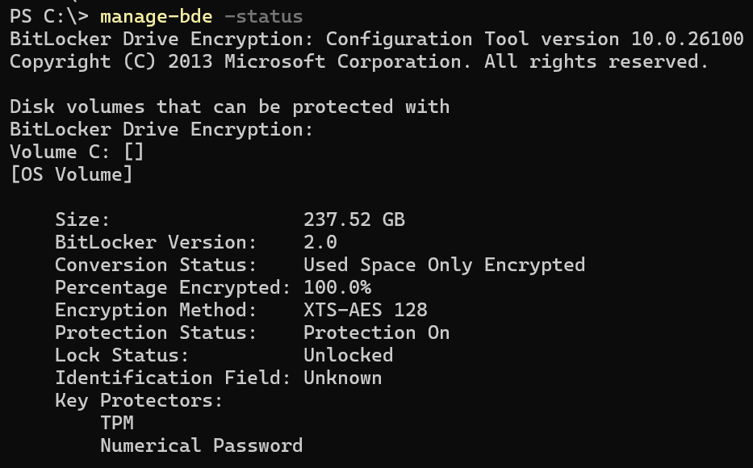
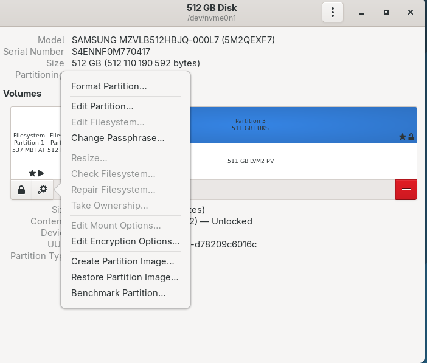

In my [Secure Boot post](../secure-boot-broken/) I wrote that encrypted storage is way higher on my list of priorities than Secure Boot. So here's a post on how it's done on the three major desktop systems.

## Why do you need it?

My opinion: disk encryption is important on any computer, but on a laptop it's essential. A desktop stays in your home or office and is rarely a target for thieves. A server is in a datacentre behind several locked doors, with CCTV and security guards. I prefer to encrypt them anyway, but do your own risk assessment. A laptop is a different thing because it travels.

I've been lucky so far: I've never had my own laptop stolen or lost. But it happened to people around me. Some time ago I was responsible for security in a company, and one company laptop was stolen during a business trip. If it hadn't been encrypted, it would have been a disaster. A company laptop might contain personal data, confidential projects, cached credentials to company systems. But it was encrypted. It had always been a requirement and just in case, I confirmed it in Intune. I simply took a spare laptop and gave it to the unlucky employee. A few minutes to restore data from backup instead of many hours spent on revoking accesses, meetings with lawyers, uncomfortable conversations with customers.

If we're talking about company laptops and you're in the EU (or the UK and a few other countries), there's also GDPR: a law that makes data breaches that include personal information... uncomfortable. At best, it means reporting the incident to authorities. At worst - a very heavy fine. GDPR doesn't literally say "you have to encrypt all laptops", it requires "appropriate technical and organisational measures". Since all major operating systems support disk encryption at no extra cost and in a way that's almost transparent to users, it would be hard to explain a different choice. 

It's the same with ISO/IEC 27001, NIS2 and a few more standards: it's not *literally* required, but it's *effectively* required if you want to pass the audit. Not using encryption would need a very convincing reason. Some other standards (TISAX, DORA) literally require encryption.

Even if it's not required where you live, even if it's about a private laptop - think of what it contains that you don't want others to see. Medical info, emails, personal photos, financial data. A breach might hurt not only you, but people close to you. Our PCs became exactly that - personal computers that hold everything about our lives.

## Windows: BitLocker

On Windows, the built-in solution is **BitLocker**. It's been around since Windows Vista and it's available in Pro, Enterprise and Education editions. 

### Windows Home

Home editions of Windows 10 and 11 get a simplified version called *Device Encryption*. It's not configurable, just enabled or disabled (incidentally, since version 24H2 it's on by default, but only on new installs), it requires a Microsoft account (doesn't work with a local account) and a supported TPM. Personally, if I have to use Windows, I prefer the Pro version, even at home. If you need more excuses to get it: there's also proper virtualisation, Windows Sandbox and Group Policy Editor.

### The real BitLocker

BitLocker encrypts the whole system volume (and optionally other volumes) with AES-XTS. The key that encrypts data (Volume Master Key) is itself protected by one or more *protectors*:

- **TPM only** - the key is sealed in the TPM chip and released automatically if the boot process looks untampered.
- **TPM + PIN** - the TPM still checks the boot process, but additionally requires a PIN before releasing the key.
- **TPM + startup key** - a USB stick has to be inserted during boot.
- **Password** - for systems without a TPM, or removable drives.
- **Recovery key** - a backup method: a 48-digit number, used when the main method fails.

Management is done through the control panel, or from the command line with `manage-bde` (e.g. `manage-bde -status`).

### TPM-only mode: convenient, but less secure

TPM-only mode is the default and it's great for usability: there's no need for an extra password. You log in the usual way, with a PIN or fingerprint. Until you check in the control panel, you don't even notice that the drive is encrypted.

But it's the least secure way. The laptop decrypts itself for anyone who turns it on. The only thing between a thief and your data is the Windows login screen and the assumption that the boot chain can't be tampered with. That assumption has been broken many times:

- **TPM bus sniffing.** If the TPM is a separate chip, the key travels to the CPU over an unencrypted bus (LPC or SPI). It was demonstrated in [2019 by Pulse Security](https://pulsesecurity.co.nz/articles/TPM-sniffing), and in 2024 Thomas Roth (stacksmashing) [did it in 43 seconds with a cheap Raspberry Pi Pico](https://www.tomshardware.com/pc-components/cpus/youtuber-breaks-bitlocker-encryption-in-less-than-43-seconds-with-sub-dollar10-raspberry-pi-pico). Firmware TPMs built into the CPU aren't affected, but plenty of older laptops have a discrete chip.
- **Bitpixie (CVE-2023-21563).** Downgrade the Windows Boot Manager to an old, vulnerable but still signed version, trigger a network boot, and the key stays in memory where it can be read. No screwdriver needed. Presented at 38C3 in December 2024: [Windows BitLocker: Screwed without a Screwdriver](https://media.ccc.de/v/38c3-windows-bitlocker-screwed-without-a-screwdriver). The real fix requires the Secure Boot certificate update, which (as I wrote last time) everyone should apply ASAP, but not everyone does.
- **BitUnlocker (CVE-2025-48800, CVE-2025-48003, CVE-2025-48804, CVE-2025-48818).** Four bugs in the Windows Recovery Environment, found by Microsoft's own STORM team in 2025, which allowed extracting BitLocker secrets with physical access: [BitUnlocker: Leveraging Windows Recovery to Extract BitLocker Secrets](https://techcommunity.microsoft.com/blog/microsoft-security-blog/bitunlocker-leveraging-windows-recovery-to-extract-bitlocker-secrets/4442806).

Almost all vulnerabilities in BitLocker only affect the TPM-only mode. Microsoft itself lists pre-boot authentication as a countermeasure for exactly these attacks in its [BitLocker countermeasures](https://learn.microsoft.com/en-us/windows/security/operating-system-security/data-protection/bitlocker/countermeasures) documentation.

So, my advice: on a laptop, use TPM + PIN. It's one more thing to type at boot, but it's a small price. The PIN can be longer than the name suggests, and with an "enhanced PIN" policy it can contain letters and symbols, effectively becoming a password.

What if you're configuring a system for someone who would complain when forced to type another password? I'd say that TPM-only BitLocker is still much better than no encryption. It won't stop an intelligence agency, but it will stop an ordinary thief.

### Recovery keys: inconvenient, but necessary

If you use any of the TPM-backed modes, sooner or later BitLocker will ask you for the recovery key. It does it when something suspicious happens with the boot process. Replaced hardware, a firmware update and some OS updates can trigger it. The situation is improving - Windows Update attempts to suspend BitLocker before an update, so do other driver update tools from Dell, HP, Lenovo etc. Most of the time, it works, sometimes it doesn't. Which means you have to keep the recovery key.

On Windows Home, it's always stored on your Microsoft account. You can see it at https://account.microsoft.com/devices/recoverykey (short link: https://aka.ms/myrecoverykey ). This solution ensures you won't lose it. When you're locked out of your laptop, all you need is another device (a smartphone works). But it means you're sharing the key to your data with Microsoft. Perhaps the NSA too. Although they're unlikely to be after your data (probably).

Company computers typically also store the key with Microsoft, on the Entra ID account. A user can check their own key, but an administrator can check keys for other users, for example in Intune. Which usually saves the day, because few users know where to find their recovery key.

An alternative, if you're on Windows Pro, is to save the key to a file (outside the encrypted drive) or print it. The latter is convenient if you expect to need the key (you're about to replace a major component). If you decide to keep your key outside of Microsoft's reach, be really sure that you have a copy available (e.g. print it and keep it in a safe).

## Linux: LUKS and many choices

On Linux, the standard is **LUKS** (Linux Unified Key Setup) on top of dm-crypt, managed with `cryptsetup`. As usual on Linux, there's more than one way to do it, and the choices come with different trade-offs:

- **Full disk encryption, including /boot.** GRUB can unlock a LUKS volume itself, so even the kernel and initramfs are encrypted. It's the most secure option, but GRUB's LUKS2 support has long been limited. I learned the hard way that even the Ubuntu installer allows you to choose an unbootable combination.
- **Everything except /boot.** /boot is a small separate unencrypted partition with the kernel and initramfs. Everything else (root, home, swap) lives inside LUKS, often with LVM on top. The initramfs asks for the passphrase and unlocks the rest. This is what most distro installers do when you tick the "encrypt" checkbox.
- **Just /home (or other data partitions).** The system is unencrypted, only user data is protected. Faster boot, the computer can start without anyone typing a password (useful for a server). But be aware that even if all your data is on encrypted filesystems, it still leaks into other places - swap, /tmp, logs. 

My personal preference for the laptop: **/boot on a separate unencrypted filesystem, everything else encrypted with LUKS**, unlocked by a passphrase at boot. It's simple, well tested, and I know how to fix it when something breaks. The unencrypted /boot is a theoretical weak point (someone could replace the initramfs with a version that records my passphrase - the Evil Maid attack), and Secure Boot only partly helps here, since on most distros the initramfs is generated locally and not signed. I accept that risk: I'm not a target for the NSA. I'm geographically closer to the FSB, and they would perform a different type of cryptanalysis.

[")](https://xkcd.com/538/)

Incidentally, Ubuntu 26.10 which has just shipped [does NOT support encrypted /boot if Secure Boot is enabled](https://ubuntu.com/blog/ubuntu-26-10-security). This sounds counterintuitive, but it's a part of an effort to reduce the amount of code that runs on the highest trust level. The secure version of GRUB is limited in many other ways - it doesn't support ZFS and btrfs, doesn't display images. Just barely enough to boot and let the kernel handle the rest. Standard GRUB is quite complex, it's almost a separate operating system, so slimming it down is a step in the right direction. Trade-offs everywhere.

### Managing LUKS

It's much easier to encrypt the hard drive during the installation. You can't encrypt (or decrypt) a live system. You need at least a brief downtime: boot from a USB drive, shrink the filesystem to make space for the LUKS header (alternatively - you can use a detached header in a separate file) and configure the filesystem for encryption. You can then reboot before it's fully encrypted, the encryption will continue after the reboot. It's not THAT hard (just a few simple commands), but hard enough to discourage most people from trying. Perhaps one day LUKS will get a fully live option similar to BitLocker (at least for the most common scenarios - given many possible combinations in the Linux block device layers, there won't be a way to cover all of them).

However, standard operations on the encrypted drive are simple.

- Generally, it just works. You need to enter the password at every boot, but it will never surprise you with an unexpected prompt.
- Changing the password is `sudo cryptsetup luksChangeKey /dev/sda3` (replace sda3 with your device name).
- Displaying the information is `sudo cryptsetup luksDump /dev/sda3`.
- LUKS has many key slots (8 in LUKS1, 32 in LUKS2) that all unlock the same device. Useful if several admins need access to the same server. Or to have a similar setup to what BitLocker does: main (non-password) method + recovery key. I covered it on my selfhosting blog when describing [encryption options for a server](https://selfhosting.too-many-machines.com/home/nas-2/).

There are also LUKS GUIs provided by Gnome, KDE and others, but I never use them. I don't use GUI on my servers, and on my laptop it's more convenient for me to do it the same way.

### TPM-backed unlocking

Linux can also use the TPM, like BitLocker does. The tools are systemd-cryptenroll or Clevis. The key gets sealed to selected PCRs (TPM registers holding measurements of firmware, bootloader, Secure Boot state, kernel etc.) and the disk unlocks automatically if they match. Optionally, with a PIN.

**Ubuntu 26.04** made this mainstream (and older versions since 23.10 had experimental support). See the [Ubuntu Blog](https://ubuntu.com/blog/ubuntu-26-04-lts-security-updates) for details. It seems like an enterprise solution, similar to BitLocker: with recovery key handling, warnings before firmware updates that would break unlocking, and management in the Security Center. It works because Canonical controls the whole chain: the kernel and initramfs are shipped together as a [Unified Kernel Image](https://documentation.ubuntu.com/security/security-features/storage/encryption-full-disk/) built and signed by Canonical. It does have requirements: Secure Boot, TPM 2.0, and it doesn't support third-party drivers built locally (there are also reports of it failing on some hardware).

**Why is it a problem on other distros?** Most of them build the initramfs locally, on every kernel update or driver installation. You're left with two bad options:

- **Bind only to the Secure Boot state (PCR 7).** Updates don't break anything, but the initramfs and kernel command line are not protected. This is not just theoretical: in 2025 a blog post showed how to [bypass TPM2 auto-unlock in about 10 minutes](https://oddlama.org/blog/bypassing-disk-encryption-with-tpm2-unlock/) by replacing the LUKS partition with a fake one, getting a shell in the initramfs, and then asking the TPM for the real key (which it happily provides since the PCRs still match). Earlier, Pulse Security found you could [bypass Clevis TPM unlocking by repeatedly pressing Enter](https://www.pulsesecurity.co.nz/advisories/tpm-luks-bypass) (which sounds crazy, but it's a consequence of the boot system dropping you to an emergency shell if something goes wrong).
- **Bind to more PCRs (kernel, initramfs, command line).** Much more secure, but every kernel/initrd update changes the measurements, so the TPM refuses to unlock and you have to type the recovery passphrase and re-enrol. That's what Windows does - but on Windows, an update triggers the need for the recovery key maybe once a year. On Debian Testing, which I run on my personal laptop, that would be closer to twice per week (on stable distros it's something in between).

Things are getting better - systemd has been working on signed UKIs and systemd-pcrlock to predict PCR values, and some distros are moving in that direction. But for now, outside of Ubuntu, TPM-backed unlocking is DIY. I tested it - it sort of worked, I'm not sure how secure it really was (it has the same underlying issues as BitLocker in TPM-only mode, but less tested), and too often it failed to boot and I had to use the recovery password.

And even on Ubuntu, I'm still not convinced. Even though I happily run experimental software, that's too much complexity in exactly the place where I want trusted code only.

### Other ways

In LUKS, you can use a file as an encryption key. Of course, the file needs to be stored on another filesystem. You can also get the key from a network server. None of these seem practical for a laptop.

## macOS: FileVault

I don't use a Mac personally, but I supported them for other people. **FileVault** is Apple's disk encryption, built into macOS. On modern Macs (Apple silicon and even some newer Intel-based), the internal storage is actually always encrypted by the dedicated AES engine managed by the Secure Enclave. What FileVault adds is tying that encryption key to the user's password, so the data can't be read without logging in. Before that, the disk is encrypted, but decrypts itself at boot - similar to BitLocker in TPM-only mode.

The setup assistant offers to enable it during the first start, and it's a sensible default. A few things that I learned while supporting it:

- The user's login password is what unlocks the disk, so make sure it's a decent one.
- You can store the recovery key in iCloud, or get a recovery key to store somewhere yourself. Choose one, and make sure it's actually there. In a company, the recovery keys should be escrowed in the MDM system.
- You almost never need the recovery key. The only usual reason is a forgotten password. Perhaps there is a combination of software and hardware failures that triggers it, but I've never seen it. You definitely won't need it after a routine update.

I don't like Macs anyway. But I have to admit: their implementation of disk encryption is the least troublesome of the three. Apple controls the hardware and the software, and it shows.

## The downsides

Disk encryption isn't free. Here's what you pay:

- **Unexpected recovery prompts.** That affects BitLocker and LUKS in the TPM mode. Whenever something is changed in the boot process, you're asked for the recovery key. Inconvenient for technically savvy people, a major obstacle for those who expect their system to "just work". Many admins learned it the hard way in July 2024, when the CrowdStrike update crashed millions of Windows computers and the fix required booting into recovery mode, which needed the BitLocker recovery key. For every single computer.
- **Losing the key means losing the data.** Forget the passphrase, lose the recovery key, and the data is gone. That's the point of encryption, but it can hurt you one day. That's why Apple and Microsoft offer keeping the recovery key for you. Also, keep backups (which you should do anyway).
- **Harder data recovery.** If something goes wrong with the boot process, both Windows and Linux give you some recovery options. You can also move the drives to another machine to recover files. If the drive is physically damaged, recovering data from an unencrypted disk is sometimes possible. Encryption limits the options and at the very least, you need the recovery key.
- **Unattended reboots.** A computer that asks for a passphrase at boot can't restart automatically. Not an issue for a laptop, a real issue for servers.
- **Performance.** On modern CPUs with AES acceleration, the impact is so low it's hard to measure. On very old or low-power hardware (some ARM boards), it can be noticeable. 
- **It only protects a computer that's turned off.** Once the disk is unlocked, encryption does nothing against malware or someone who grabs the running laptop. A laptop in sleep mode keeps the keys in RAM. If you're worried, shut it down before leaving it unattended or crossing a border.
- **False sense of security.** Proper encryption is unbreakable, but it doesn't help at all if someone can get your unencrypted backups or force you to unlock the computer.

I think the first point is the only one that matters - not for me, but for non-technical people. All the others are a really small price compared to the alternative. I've seen what the alternative would look like - and the only reason I didn't have to deal with it was that I forced everyone to encrypt and accepted no complaints.

## Quick guide: configuring encryption for someone who wants it to "just work"

Option 1: get them a Mac. Check that FileVault is enabled.

Option 2: install Linux with password-protected LUKS. They'll need 2 passwords at every boot. You won't ever have to deal with any problems related to encryption. Just countless support requests about everything else.

Option 3: configure Windows with standard, TPM-only encryption, no PIN. Check the key was backed up to their Microsoft account, because it sometimes fails. Print the recovery key twice, tell them to store one copy securely, keep the other one. Explain that one day the system might ask them for the key, it doesn't mean it's broken. Show them an example screen. Tell them to call you if that happens.

Great, I guess I accidentally wrote a pro-Apple post.